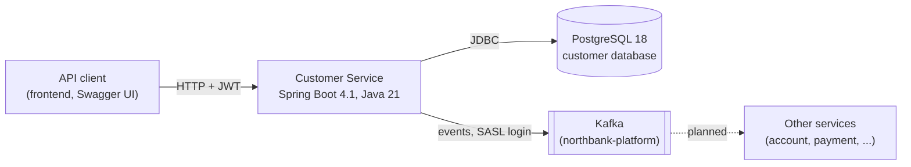
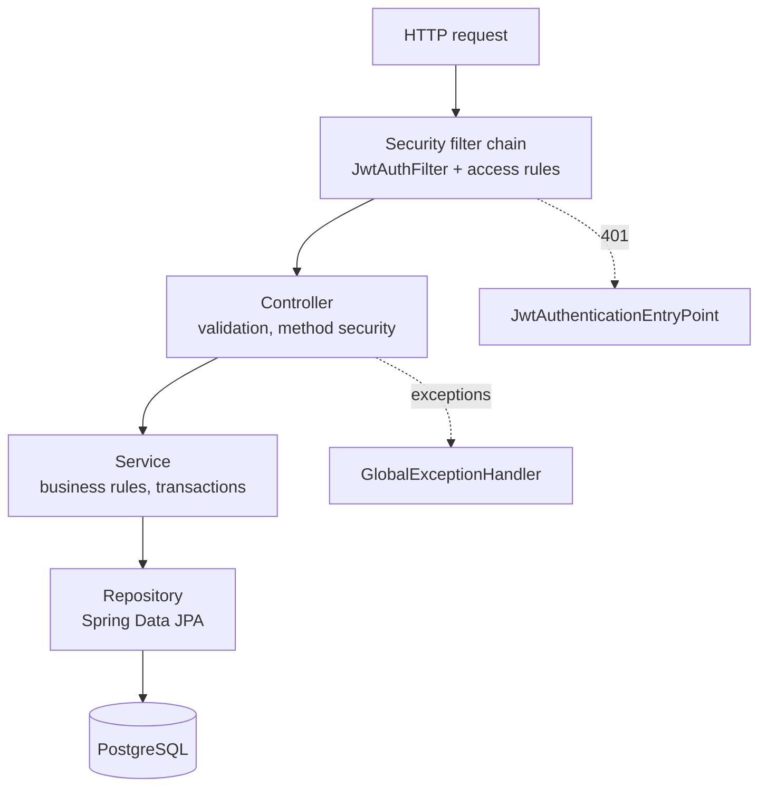
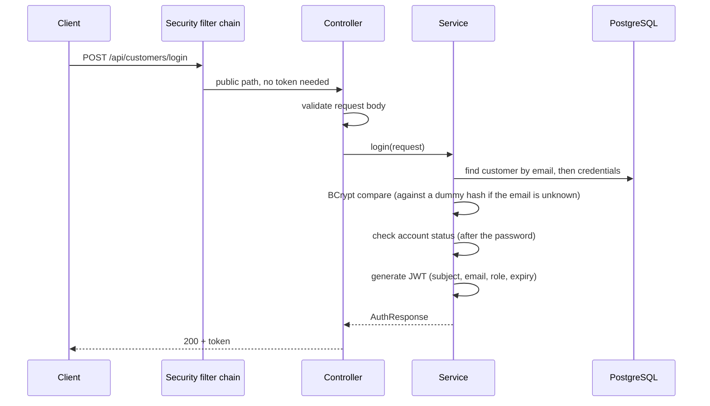
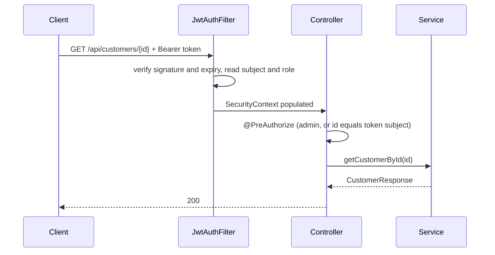
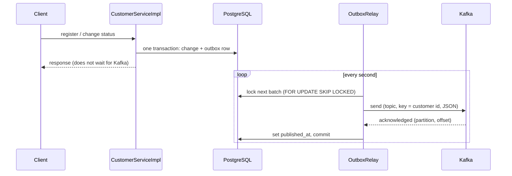
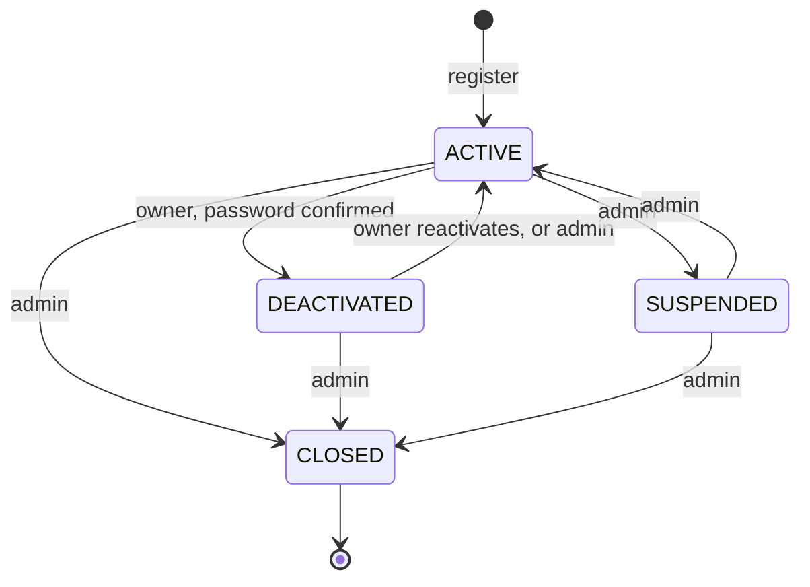

# Customer Service: Architecture

Registration, authentication and customer management for the NorthBank platform. This is the first
of several services. Each service owns its data and is deployed on its own.

## 1. Context


Solid lines exist today. The dotted line is planned (section 11).

## 2. Layers



| Layer | Responsibility | Must not |
|---|---|---|
| Security | Validate the JWT, build the authenticated user, enforce public vs protected paths | Contain business rules |
| Controller | HTTP mapping, `@Valid`, `@PreAuthorize`, status codes | Contain business logic, return entities |
| Service | Business rules, status transitions, transactions, audit logging, recording events | Know about HTTP |
| Repository | Queries (derived methods and Specifications) | Contain logic |
| Entity | Persistence model | Leave the service layer |
| DTO and mapper | The API contract, and the only objects clients see | Expose passwords or internal fields |
| Exception | Typed business errors, one mapping to HTTP | Leak internals |

## 3. Package layout
```
com.northbank.customerservice
├── controller/           CustomerController
├── service/customer/     CustomerService and CustomerServiceImpl
├── repository/           CustomerRepository, CredentialsRepository, CustomerSpecifications
├── entity/               Customer, Credentials, Status, Role
├── dto/                  request/ and response/ (including PageResponse, AdminResponse, ErrorResponse)
├── mapper/               CustomerMapper, AdminMapper
├── security/             SecurityConfig, JwtService, JwtAuthFilter, JwtAuthenticationEntryPoint, SecurityUtils
├── exception/            custom exceptions, GlobalExceptionHandler
├── event/                EventTopics, CustomerEvent, CustomerRegisteredEvent, CustomerStatusChangedEvent
├── outbox/               OutboxEvent, OutboxEventRepository, OutboxService, OutboxRelay, OutboxMaintenance, DurationFormat
└── config/               OpenApiConfig, AdminSeeder, SchedulingConfig, KafkaConnectivityCheck
```

## 4. Request flows

### Login


### Authenticated request

A missing, expired or invalid token is not rejected by the filter itself. The filter records why, and the
authentication entry point turns it into a `401` JSON body.

## 5. Events and the transactional outbox
Other services learn about customers through events on Kafka. Customer Service must write to its database
and tell Kafka, and those cannot commit together. The outbox removes the gap: the event is saved as a row
in the same transaction as the change, and a relay publishes it afterwards.



**Guarantees:** at-least-once delivery, ordered per customer, nothing lost if Kafka is down. Consumers must
ignore duplicates by `eventId`. See [events.md](events.md) for the contract.

Events are recorded by `OutboxService`, which refuses to run outside a transaction. That makes it impossible
to save an event without the change it describes, or the change without its event. The first admin created by
`AdminSeeder` also records a registration event, so every customer row has one.

### Failure handling

| Situation | What the relay does |
|---|---|
| Kafka unreachable, timeouts, authentication or authorization errors | Stops the cycle and retries with backoff (1 s doubling to 30 s). Applies to every event, so nothing is set aside. |
| The event itself cannot be sent (record too large, serialization or topic-name error) | Quarantines it, logs an ERROR, and holds back only that customer's later events so order is preserved. Other customers carry on. |
| Process crashes after Kafka acknowledged, before the commit | The event is sent again after restart. Consumers deduplicate. |

### Housekeeping
`OutboxMaintenance` deletes published rows older than 7 days, hourly, in batches of 500. Every minute it logs
an ERROR if any event is quarantined, or any event has waited longer than 5 minutes. The relay, the purge and
the report run on separate scheduler threads (`spring.task.scheduling.pool.size=3`), so a slow Kafka call
cannot silence the alerts. Scheduling is enabled in `SchedulingConfig`, not on the relay, so the maintenance
jobs still run when the relay is switched off.

### Configuration

| Property | Default |
|---|---|
| `outbox.relay.enabled` | true |
| `outbox.relay.batch-size` | 50 |
| `outbox.relay.poll-interval-ms` | 1000 |
| `outbox.relay.send-timeout-seconds` | 12 |
| `outbox.relay.backoff-initial-ms` / `backoff-max-ms` | 1000 / 30000 |
| `outbox.maintenance.enabled` | true |
| `outbox.maintenance.retention-days` | 7 |
| `outbox.maintenance.purge-batch-size` | 500 |
| `outbox.maintenance.purge-cron` | `0 15 * * * *` (minute 15 of every hour) |
| `outbox.maintenance.stuck-after-minutes` | 5 |
| `outbox.maintenance.report-interval-ms` | 60000 |

Producer settings: `acks=all` with idempotence. The producer waits at most 5 s for metadata (`max.block.ms`)
and 10 s per record (`delivery.timeout.ms`), shorter than the relay's 12 s wait, so a timed-out send is never
still in flight when the relay records the failure. Reconnect delays grow from 0.5 s to a 3 s cap. The
framework's own failure logger is switched off, because it duplicates the relay's line and prints part of the
payload.

### Logs

| Log line | Level | Meaning |
|---|---|---|
| `Published <type> event <id> for customer <id> to <topic> [partition, offset] waited <time>` | INFO | Kafka acknowledged the record |
| `Cannot publish outbox event <id> ... (attempt n); backing off` | WARN | Kafka or the network is the problem. The relay will retry. |
| `Outbox event <id> ... quarantined, needs manual resolution` | ERROR | The event itself is the problem. A person must act. |
| `OUTBOX STUCK: n event(s) waiting, the oldest for <time>` | ERROR | Events have waited longer than the threshold |
| `OUTBOX ATTENTION: n quarantined event(s) need manual resolution` | ERROR | Repeats every minute until the events are released |
| `Outbox purge removed n published events older than <time>` | INFO | Housekeeping |

### Operating the outbox
Run these in `psql` from the customer-service folder:
`docker compose exec db sh -c 'psql -U "$POSTGRES_USER" -d "$POSTGRES_DB"'`

For anything that changes data, preview with a `SELECT` using the same `WHERE`, then run the change inside
`BEGIN;` and finish with `COMMIT;` or `ROLLBACK;`. Never leave a transaction open: the relay skips locked
rows, so an open transaction makes events look stuck.

What is waiting (quarantined events first):
```sql
SELECT id, event_type, aggregate_id, attempts, quarantined_at, left(last_error, 80) AS last_error
FROM outbox_events
WHERE published_at IS NULL
ORDER BY (quarantined_at IS NULL), id;
```

Release quarantined events after fixing the cause (the relay picks them up on its next cycle):
```sql
UPDATE outbox_events
SET quarantined_at = NULL, attempts = 0, last_error = NULL
WHERE quarantined_at IS NOT NULL AND published_at IS NULL;
```

Re-publish events already marked as sent, for example after Kafka lost data (published rows are kept for
7 days):
```sql
UPDATE outbox_events SET published_at = NULL WHERE id >= 10;
```
Replay from the first affected event onward, never a single old event, or a consumer could apply an old
status over a newer one. Consumers must tolerate duplicates.

### Kafka access
The service logs in as `customer_service` and may only write `customer.*` topics. It cannot read topics or
create them. Topics and permissions are managed in the `northbank-platform` repository.

## 6. Security model

**Authentication.** Stateless JWT. The token is signed with an HMAC key from `JWT_SECRET` and carries the
customer id (subject), email, role and expiry. Sessions are disabled and CSRF is off, which suits a
token-based JSON API.

**Authorization.**

| Endpoint | Access |
|---|---|
| `POST /register`, `POST /login`, `POST /reactivate` | Public |
| `GET`, `PATCH /{id}` | Owner or admin, active accounts only |
| `PATCH /{id}/password`, `PATCH /{id}/deactivate` | Owner only |
| `GET /api/customers` (paging, sorting, filters) | Admin |
| `PATCH /{id}/status`, `PATCH /{id}/role` | Admin, never on their own account |

**Passwords.** BCrypt hashes in a separate table. One policy (8 to 64 characters, upper and lower case,
digit, special character, no leading or trailing space) is applied to registration, password change and the
bootstrap admin. Passwords are never trimmed or logged.

**Login hardening.** Every failure returns the same `401` message. A dummy BCrypt comparison runs for unknown
emails, so response time doesn't reveal which accounts exist. The account status is checked only after the
password is correct, so an unauthenticated caller never learns an account's state.

**Kafka.** The service authenticates to the broker with its own identity and least-privilege permissions
(section 5). Event payloads contain ids, statuses and timestamps only, never personal data.

## 7. Account lifecycle


The rules live in one place, `Status.canTransitionTo`, and every flow goes through it. A suspended
customer cannot reach `DEACTIVATED`, so self-service can never undo a suspension. Rows are never
deleted, which keeps an audit trail. Every transition records a `CustomerStatusChanged` event.

## 8. Error handling
Every error uses one JSON shape: `{ message, status, timestamp, errors? }`. `errors` appears only for
validation failures and maps each field to its message.

| Cause | HTTP |
|---|---|
| Validation, malformed body, bad parameter, rule violation | 400 |
| Wrong credentials, or missing, invalid or expired token | 401 |
| Not your account, admin required, account not active | 403 |
| Customer not found | 404 |
| Duplicate email or phone, forbidden status transition | 409 |
| Anything unexpected (logged, generic message returned) | 500 |

## 9. Configuration and deployment
- **Configuration** comes from environment variables, loaded from `.env` locally. `.env` is git-ignored
  and `.env.example` documents the variables. The README lists them all.
- **Docker Compose** runs the app and PostgreSQL. The database keeps its data in a named volume.
- **The image** is built in two stages and runs as a non-root user. It contains no `.env`.
- **Kafka** runs from the separate `northbank-platform` repository and must be started first. The service
  starts and serves requests without it: events wait in the outbox and publish when Kafka returns.
- **Startup.** Flyway applies pending migrations, then `AdminSeeder` creates the first admin (and records its
  registration event) if no active admin exists and the environment supplies credentials.
  `KafkaConnectivityCheck` logs whether the broker is reachable and the service may describe its topics. It
  never blocks startup.
- **Persistence:** `spring.jpa.open-in-view=false`. Entities are mapped to DTOs inside the service layer,
  and the integration test covers the lazy-loading paths.
- **API docs:** Swagger UI at `/swagger-ui.html`.

## 10. Design decisions

| Decision | Why | Trade-off |
|---|---|---|
| Profile and credentials in two tables | Keeps secrets away from profile data and out of every profile query | One extra lookup at login |
| Application-generated UUIDs plus `Persistable` | Ids can be created before saving, and `save()` correctly inserts instead of merging | A little entity boilerplate |
| Stateless JWT | No session store, horizontal scaling is simple | Tokens can't be revoked, and a changed role or status applies at the next login |
| Authorization with `@PreAuthorize` and ownership checks | Declarative, next to the endpoint, and tested through MockMvc | Rules are spread across controller annotations |
| Status as a state machine | One rule set for all flows, easy to test | Adding a status means updating the table and its test |
| Flyway owns the schema | Reviewable, versioned changes | Applied migrations can't be edited |
| Soft delete only | Audit trail and legal retention | Data stays until a retention policy exists |
| `open-in-view` disabled | Database connections aren't held for the whole HTTP request, and lazy loading outside a transaction fails immediately instead of silently running extra queries | Lazy associations must be read inside a `@Transactional` service method |
| Secrets from the environment | Nothing sensitive in git or the image | Each environment must supply them |
| Transactional outbox | The change and its event commit together, so neither can exist without the other | A relay and housekeeping to run |
| Events carry ids and statuses only | Personal data stays in the service that owns it (UK GDPR) | Consumers keep their own copy of what they need |
| JSON text as the Kafka value | One mapper, no Kafka-specific serializer settings, consumers parse it into their own types | The contract lives in documentation and tests, not a schema registry |
| Per-customer ordering: a quarantine blocks only that customer | A later event can never overtake an earlier one for the same customer | One stuck customer waits for manual release |

## 11. Known limitations and planned evolution
- Tokens can't be revoked. Logout, refresh tokens and a revocation list are not built.
- No rate limiting or password reset yet.
- **Planned:** move authentication to an OAuth2 identity provider when the API gateway is added.
- Run **one relay instance**. With several, `SKIP LOCKED` lets them take different batches, and per-customer
  order can break.
- At the defaults the relay moves at most about 50 events per second. Raise `batch-size` for more.
- Alerts are log lines until metrics (Actuator) exist.
- Customers and the admin created **before the outbox existed have no events.** A consumer that starts later
  must be seeded some other way (a snapshot event or a backfill). Decide this with the first consumer.
- Local Kafka uses SASL over plaintext. **TLS is required before any networked deployment.**

## 12. Testing

| Level | Tools | What it proves |
|---|---|---|
| Unit | JUnit 5, Mockito | Business rules, ordering of checks, nothing saved on failure |
| Web layer | MockMvc | Security rules (401, 403), validation, error JSON shape |
| Integration | Testcontainers (PostgreSQL) | Migrations match entities, persistence, lazy loading, the full customer flow |

Planned: unit tests for the relay (backoff, quarantine, per-customer ordering), the maintenance job and
`OutboxService`; event contract tests that pin the JSON field names; and a Testcontainers Kafka test for the
real publish path.