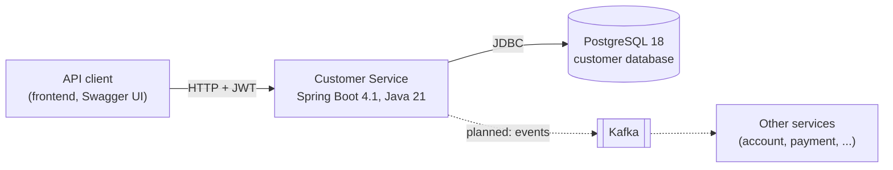
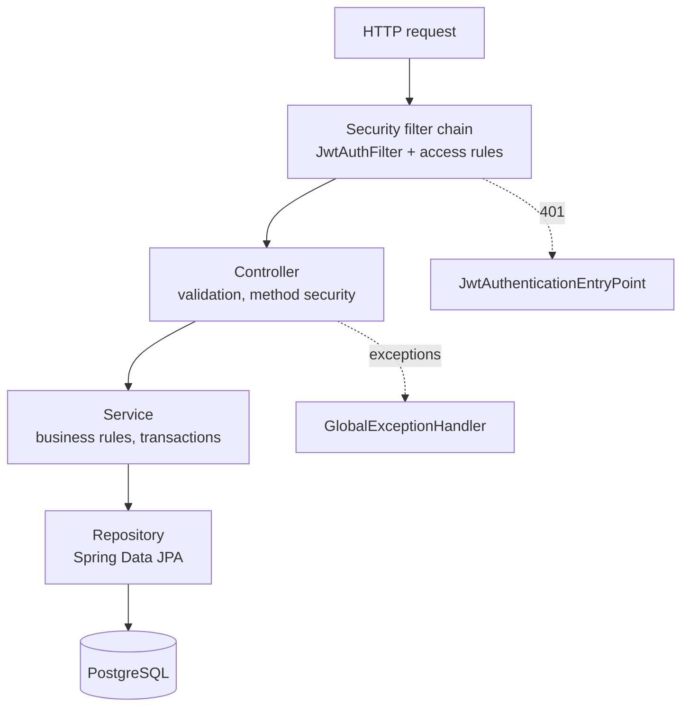
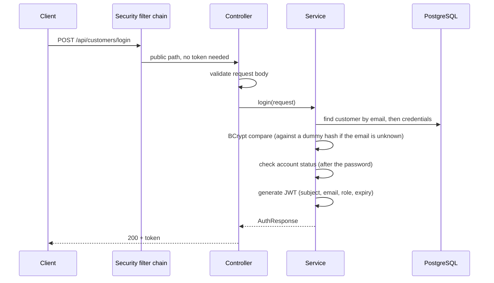
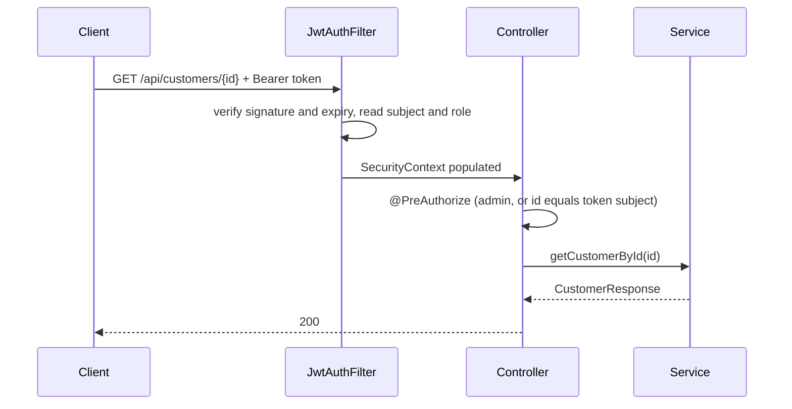
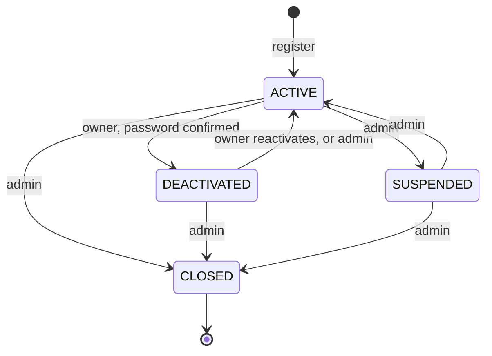

# Customer Service: Architecture

Registration, authentication and customer management for the NorthBank platform. This is the first
of several services. Each service owns its data and is deployed on its own.

## 1. Context


Solid lines exist today. Dotted lines are planned (section 10).

## 2. Layers



| Layer | Responsibility | Must not |
|---|---|---|
| Security | Validate the JWT, build the authenticated user, enforce public vs protected paths | Contain business rules |
| Controller | HTTP mapping, `@Valid`, `@PreAuthorize`, status codes | Contain business logic, return entities |
| Service | Business rules, status transitions, transactions, audit logging | Know about HTTP |
| Repository | Queries (derived methods and Specifications) | Contain logic |
| Entity | Persistence model | Leave the service layer |
| DTO and mapper | The API contract, and the only objects clients see | Expose passwords or internal fields |
| Exception | Typed business errors, one mapping to HTTP | Leak internals |

## 3. Package layout
```
com.northbank.customerservice
├── controller/           CustomerController
├── service/customer/     CustomerService and CustomerServiceImpl
├── repository/           CustomerRepository, CredentialsRepository, CustomerSpecifications
├── entity/               Customer, Credentials, Status, Role
├── dto/                  request/ and response/ (including PageResponse, AdminResponse, ErrorResponse)
├── mapper/               CustomerMapper, AdminMapper
├── security/             SecurityConfig, JwtService, JwtAuthFilter, JwtAuthenticationEntryPoint, SecurityUtils
├── exception/            custom exceptions, GlobalExceptionHandler
└── config/               OpenApiConfig, AdminSeeder
```

## 4. Request flows

### Login


### Authenticated request

A missing, expired or invalid token is not rejected by the filter itself. The filter records why, and the
authentication entry point turns it into a `401` JSON body.

## 5. Security model

**Authentication.** Stateless JWT. The token is signed with an HMAC key from `JWT_SECRET` and carries the
customer id (subject), email, role and expiry. Sessions are disabled and CSRF is off, which suits a
token-based JSON API.

**Authorization.**

| Endpoint | Access |
|---|---|
| `POST /register`, `POST /login`, `POST /reactivate` | Public |
| `GET`, `PATCH /{id}` | Owner or admin, active accounts only |
| `PATCH /{id}/password`, `PATCH /{id}/deactivate` | Owner only |
| `GET /api/customers` (paging, sorting, filters) | Admin |
| `PATCH /{id}/status`, `PATCH /{id}/role` | Admin, never on their own account |

**Passwords.** BCrypt hashes in a separate table. One policy (8 to 64 characters, upper and lower case,
digit, special character, no leading or trailing space) is applied to registration, password change and the
bootstrap admin. Passwords are never trimmed or logged.

**Login hardening.** Every failure returns the same `401` message. A dummy BCrypt comparison runs for unknown
emails, so response time doesn't reveal which accounts exist. The account status is checked only after the
password is correct, so an unauthenticated caller never learns an account's state.

## 6. Account lifecycle


The rules live in one place, `Status.canTransitionTo`, and every flow goes through it. A suspended
customer cannot reach `DEACTIVATED`, so self-service can never undo a suspension. Rows are never
deleted, which keeps an audit trail.

## 7. Error handling
Every error uses one JSON shape: `{ message, status, timestamp, errors? }`. `errors` appears only for
validation failures and maps each field to its message.

| Cause | HTTP |
|---|---|
| Validation, malformed body, bad parameter, rule violation | 400 |
| Wrong credentials, or missing, invalid or expired token | 401 |
| Not your account, admin required, account not active | 403 |
| Customer not found | 404 |
| Duplicate email or phone, forbidden status transition | 409 |
| Anything unexpected (logged, generic message returned) | 500 |

## 8. Configuration and deployment
- **Configuration** comes from environment variables, loaded from `.env` locally. `.env` is git-ignored
  and `.env.example` documents the variables.
- **Docker Compose** runs the app and PostgreSQL. The database keeps its data in a named volume.
- **The image** is built in two stages and runs as a non-root user. It contains no `.env`.
- **Startup.** Flyway applies pending migrations, then `AdminSeeder` creates the first admin if no active
  admin exists and the environment supplies credentials.
- **Persistence:** `spring.jpa.open-in-view=false`. Entities are mapped to DTOs inside the service layer,
  and the integration test covers the lazy-loading paths.
- **API docs:** Swagger UI at `/swagger-ui.html`.

## 9. Design decisions

| Decision | Why | Trade-off |
|---|---|---|
| Profile and credentials in two tables | Keeps secrets away from profile data and out of every profile query | One extra lookup at login |
| Application-generated UUIDs plus `Persistable` | Ids can be created before saving, and `save()` correctly inserts instead of merging | A little entity boilerplate |
| Stateless JWT | No session store, horizontal scaling is simple | Tokens can't be revoked, and a changed role or status applies at the next login |
| Authorization with `@PreAuthorize` and ownership checks | Declarative, next to the endpoint, and tested through MockMvc | Rules are spread across controller annotations |
| Status as a state machine | One rule set for all flows, easy to test | Adding a status means updating the table and its test |
| Flyway owns the schema | Reviewable, versioned changes | Applied migrations can't be edited |
| Soft delete only | Audit trail and legal retention | Data stays until a retention policy exists |
| `open-in-view` disabled | Database connections aren't held for the whole HTTP request, and lazy loading outside a transaction fails immediately instead of silently running extra queries | Lazy associations must be read inside a `@Transactional` service method |
| Secrets from the environment | Nothing sensitive in git or the image | Each environment must supply them |

## 10. Known limitations and planned evolution
- Tokens can't be revoked. Logout, refresh tokens and a revocation list are not built.
- No rate limiting or password reset yet.
- **Planned:** move authentication to an OAuth2 identity provider when the API gateway is added.
- **Planned:** publish `customer.registered` and `customer.status-changed` events to Kafka through a
  transactional outbox. Other services will keep their own copy of what they need, instead of calling this
  service or reading its tables.

## 11. Testing

| Level | Tools | What it proves |
|---|---|---|
| Unit | JUnit 5, Mockito | Business rules, ordering of checks, nothing saved on failure |
| Web layer | MockMvc | Security rules (401, 403), validation, error JSON shape |
| Integration | Testcontainers (PostgreSQL) | Migrations match entities, persistence, lazy loading, the full customer flow |