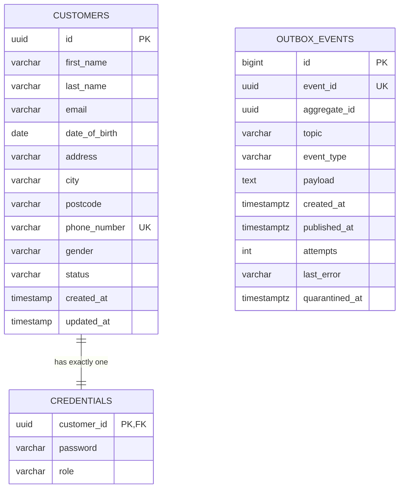

# Customer Service: Database

PostgreSQL 18. This service owns its database. No other service reads or writes these tables.
Other services refer to a customer by id value only, never by foreign key, and learn about changes
through events.

## Entity relationship diagram


`OUTBOX_EVENTS` has no relationship line on purpose: `aggregate_id` holds a customer id as a plain value,
not a foreign key.

## `customers`

| Column | Type | Constraints | Notes |
|---|---|---|---|
| `id` | UUID | PK | Generated by the application, no database default |
| `first_name` | VARCHAR(100) | NOT NULL | |
| `last_name` | VARCHAR(100) | NOT NULL | |
| `email` | VARCHAR(255) | NOT NULL, UNIQUE | Lowercased by the application |
| `date_of_birth` | DATE | NOT NULL | |
| `address` | VARCHAR(255) | | Java field is `address` |
| `city` | VARCHAR(100) | | |
| `postcode` | VARCHAR(10) | | |
| `status` | VARCHAR(20) | NOT NULL, default `ACTIVE` | Enum `Status` |
| `created_at` | TIMESTAMP | NOT NULL, default `now()` | Set by the application. No time zone |
| `updated_at` | TIMESTAMP | NOT NULL, default `now()` | Set by the application. No time zone |
| `phone_number` | VARCHAR(20) | UNIQUE | Added in V2 |
| `gender` | VARCHAR(20) | | Added in V2 |

## `credentials`

| Column | Type | Constraints | Notes |
|---|---|---|---|
| `customer_id` | UUID | PK, FK to `customers(id)` | Shared primary key: one row per customer |
| `password` | VARCHAR(255) | NOT NULL | BCrypt hash. Java field is `password` |
| `role` | VARCHAR(20) | NOT NULL, default `CUSTOMER` | Enum `Role` |

## `outbox_events`
Events waiting to be published to Kafka. A row is written in the same transaction as the change it
describes, so the change and its event are saved together or not at all. See the
[architecture](architecture.md) for how the relay uses it.

| Column | Type | Constraints | Notes |
|---|---|---|---|
| `id` | BIGSERIAL | PK | Publish order. A sequence never ties, unlike a timestamp. Never leaves the service. |
| `event_id` | UUID | NOT NULL, UNIQUE | The event's identity, sent inside the message. Consumers deduplicate on it. |
| `aggregate_id` | UUID | NOT NULL | The customer id. Used as the Kafka key, so one customer's events stay in order. |
| `topic` | VARCHAR(100) | NOT NULL | Destination topic |
| `event_type` | VARCHAR(100) | NOT NULL | For example `CustomerRegistered` |
| `payload` | TEXT | NOT NULL | The exact JSON that is sent. `TEXT`, not `JSONB`, because `JSONB` normalises the JSON. |
| `created_at` | TIMESTAMPTZ | NOT NULL, default `now()` | |
| `published_at` | TIMESTAMPTZ | | Set when Kafka acknowledged the record |
| `attempts` | INT | NOT NULL, default 0 | Failed attempts so far. Informational. |
| `last_error` | VARCHAR(500) | | Cause of the most recent failure |
| `quarantined_at` | TIMESTAMPTZ | | Set when the event itself cannot be published and a person must act |

### Row states

| State | `published_at` | `quarantined_at` | Meaning |
|---|---|---|---|
| Waiting | empty | empty | The relay will publish it |
| Published | set | empty | Delivered. Deleted after 7 days. |
| Quarantined | empty | set | Set aside. Never retried until someone releases it. |

### Indexes on `outbox_events`
- `idx_outbox_unpublished` on `(id)` where `published_at IS NULL`: the relay's query.
- `idx_outbox_published_at` on `(published_at)` where `published_at IS NOT NULL`: the purge job.
- `idx_outbox_quarantined` on `(aggregate_id, id)` where `quarantined_at IS NOT NULL AND published_at IS NULL`:
  answers "is an earlier event for this customer quarantined?". These rows are rare, so the index stays tiny.

## Enumerations
Stored as text (`@Enumerated(EnumType.STRING)`), so reordering a Java enum never changes stored data.

| Column | Values |
|---|---|
| `customers.status` | `ACTIVE`, `DEACTIVATED`, `SUSPENDED`, `CLOSED` |
| `credentials.role` | `CUSTOMER`, `ADMIN` |

The database has no check constraints on these columns. The application enforces the values and the
allowed status transitions.

## Indexes
- Primary keys, and the unique constraints on `email` and `phone_number`, are indexed automatically.
- Besides the outbox indexes above, no other indexes exist. The admin list sorts and filters with
  `lower(column) LIKE '%term%'`, which a plain index can't serve. That is fine for thousands of rows. At
  scale, add a `pg_trgm` index in a new migration.

## Migrations
Flyway applies them at startup, in order, from `src/main/resources/db/migration`.

| Version | Change |
|---|---|
| V1__create_customers_table | Creates `customers` and `credentials` |
| V2__add_phone_number_and_gender_to_customers | Adds `customers.phone_number` (unique) and `customers.gender` |
| V3__create_outbox_events | Creates `outbox_events` and the unpublished-rows index |
| V4__add_outbox_quarantine_and_purge_index | Adds `quarantined_at`, the quarantine index and the purge index |

Rules for changing the schema:
1. Never edit a migration that has been applied. Add the next version instead. This includes renames: a
   renamed or edited file fails Flyway's validation at startup.
2. Make destructive changes in two steps (add the new, migrate, remove the old in a later release).
3. Run the integration test, which starts a real PostgreSQL and applies every migration.

## Design notes
- **Why two tables.** Credentials are isolated from profile data, so the password hash can never be
  returned by accident from a profile query.
- **Shared primary key.** `credentials.customer_id` is both the primary key and the foreign key, so a
  customer has at most one credentials row without any extra constraint.
- **No hard deletes.** Closing an account changes `status`. Rows stay for audit and legal retention.
- **Case sensitivity.** The unique constraint on `email` is case-sensitive. Uniqueness depends on the
  application lowercasing every email. A unique index on `lower(email)` would enforce it in the database.
- **Timestamps.** `customers` uses `TIMESTAMP` without a time zone, and `outbox_events` uses `TIMESTAMPTZ`.
  Moving `customers` to `TIMESTAMPTZ` is advisable before the system runs across time zones.
- **The outbox has no foreign key.** An event describes the past, so it must stay valid whatever later
  happens to the customer row, and the outbox must never block a change to it.
- **Two identifiers on an outbox row.** `id` is a sequence number that gives the publish order and never
  leaves the service. `event_id` is a UUID created by the application and sent inside the message, so
  consumers can recognise duplicates.
- **Published rows are temporary.** A maintenance job deletes them after 7 days. Quarantined rows are never
  deleted automatically.

## Personal data
Names, email, date of birth, address and phone number are personal data, and the password hash is a
credential. Event payloads in `outbox_events` contain ids, statuses and timestamps only, never personal data.
A retention and erasure policy for `CLOSED` accounts is not defined yet.

## Checking the live schema
```bash
docker compose exec db sh -c 'psql -U "$POSTGRES_USER" -d "$POSTGRES_DB" -c "\d customers"'
docker compose exec db sh -c 'psql -U "$POSTGRES_USER" -d "$POSTGRES_DB" -c "\d credentials"'
docker compose exec db sh -c 'psql -U "$POSTGRES_USER" -d "$POSTGRES_DB" -c "\d outbox_events"'
```