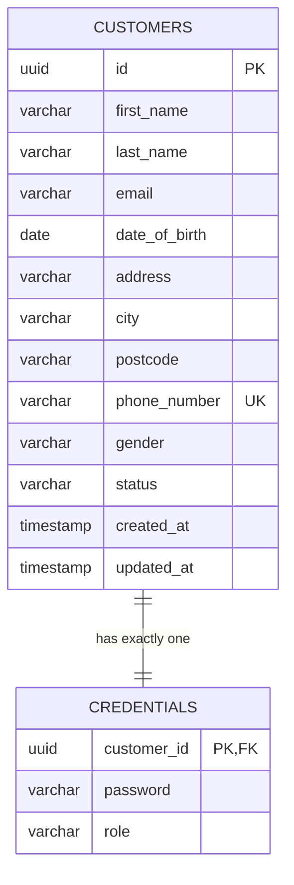

# Customer Service: Database

PostgreSQL 18. This service owns its database. No other service reads or writes these tables.
Other services refer to a customer by id value only, never by foreign key, and learn about changes
through events.

## Entity relationship diagram



## `customers`

| Column | Type | Constraints | Notes |
|---|---|---|---|
| `id` | UUID | PK | Generated by the application, no database default |
| `first_name` | VARCHAR(100) | NOT NULL | |
| `last_name` | VARCHAR(100) | NOT NULL | |
| `email` | VARCHAR(255) | NOT NULL, UNIQUE | Lowercased by the application |
| `date_of_birth` | DATE | NOT NULL | |
| `address` | VARCHAR(255) | | Java field is `address` |
| `city` | VARCHAR(100) | | |
| `postcode` | VARCHAR(10) | | |
| `status` | VARCHAR(20) | NOT NULL, default `ACTIVE` | Enum `Status` |
| `created_at` | TIMESTAMP | NOT NULL, default `now()` | Set by the application. No time zone |
| `updated_at` | TIMESTAMP | NOT NULL, default `now()` | Set by the application. No time zone |
| `phone_number` | VARCHAR(20) | UNIQUE | Added in V2 |
| `gender` | VARCHAR(20) | | Added in V2 |

## `credentials`

| Column | Type | Constraints | Notes |
|---|---|---|---|
| `customer_id` | UUID | PK, FK to `customers(id)` | Shared primary key: one row per customer |
| `password` | VARCHAR(255) | NOT NULL | BCrypt hash. Java field is `password` |
| `role` | VARCHAR(20) | NOT NULL, default `CUSTOMER` | Enum `Role` |

## Enumerations
Stored as text (`@Enumerated(EnumType.STRING)`), so reordering a Java enum never changes stored data.

| Column | Values |
|---|---|
| `customers.status` | `ACTIVE`, `DEACTIVATED`, `SUSPENDED`, `CLOSED` |
| `credentials.role` | `CUSTOMER`, `ADMIN` |

The database has no check constraints on these columns. The application enforces the values and the
allowed status transitions.

## Indexes
- Primary keys, and the unique constraints on `email` and `phone_number`, are indexed automatically.
- No other indexes exist. The admin list sorts and filters with `lower(column) LIKE '%term%'`, which
  a plain index can't serve. That is fine for thousands of rows. At scale, add a `pg_trgm` index in a new
  migration.

## Migrations
Flyway applies them at startup, in order, from `src/main/resources/db/migration`.

| Version | Change |
|---|---|
| V1__create_customers_table | Creates `customers` and `credentials` |
| V2__add_phone_number_and_gender_to_customers | Adds `customers.phone_number` (unique) and `customers.gender` |

Rules for changing the schema:
1. Never edit a migration that has been applied. Add the next version instead.
2. Make destructive changes in two steps (add the new, migrate, remove the old in a later release).
3. Run the integration test, which starts a real PostgreSQL and applies every migration.

## Design notes
- **Why two tables.** Credentials are isolated from profile data, so the password hash can never be
  returned by accident from a profile query.
- **Shared primary key.** `credentials.customer_id` is both the primary key and the foreign key, so a
  customer has at most one credentials row without any extra constraint.
- **No hard deletes.** Closing an account changes `status`. Rows stay for audit and legal retention.
- **Case sensitivity.** The unique constraint on `email` is case-sensitive. Uniqueness depends on the
  application lowercasing every email. A unique index on `lower(email)` would enforce it in the database.
- **Timestamps** use `TIMESTAMP` without a time zone. Moving to `TIMESTAMPTZ` is advisable before the
  system runs across time zones.

## Personal data
Names, email, date of birth, address and phone number are personal data, and the password hash is a
credential. A retention and erasure policy for `CLOSED` accounts is not defined yet.

## Checking the live schema
```bash
docker compose exec db sh -c 'psql -U "$POSTGRES_USER" -d "$POSTGRES_DB" -c "\d customers"'
docker compose exec db sh -c 'psql -U "$POSTGRES_USER" -d "$POSTGRES_DB" -c "\d credentials"'
```